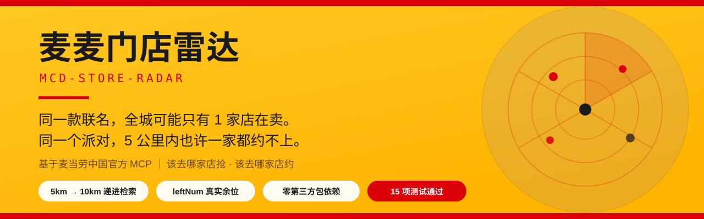
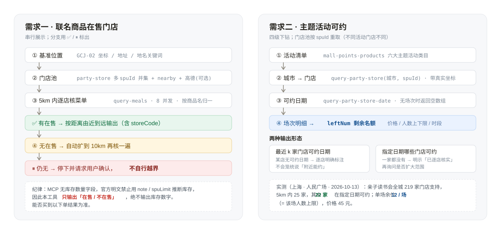

# 麦麦门店雷达 · mcd-store-radar

<div align="center">
  
</div>

> **同一款联名，全城可能只有 1 家店在卖。**
> **同一个派对，5 公里内也许一家都约不上。**
> 这个 Skill 只回答两件事：**该去哪家店抢**、**该去哪家店约**。

基于**麦当劳中国官方 MCP**开发的 WorkBuddy Skill。
**零第三方 Python 包依赖**（100% 标准库，`pip install` 不需要装任何东西），
另有**一个可选的第三方服务依赖**（高德 Web 服务 API，用于补全门店覆盖与展示评分，
可一键关闭）——详见 [第三方依赖声明](#第三方依赖声明)。
不需要 GPU、不需要数据库、不需要前端构建。

---

## 它是怎么工作的

<div align="center">
  
</div>

两条链路都遵守同一条纪律：**找不到就说找不到，要扩大范围先问用户，绝不自行越界。**

---

## 为什么做这个

市面上 400 多个参赛作品都在回答「这一单怎么点最省」。
我们把问题换成了两个**别人没回答、但麦门用户真实会问**的问题：

| 用户真实痛点 | 现有工具的答案 | 本项目的答案 |
|:---|:---|:---|
| 联名周边断货，跑三家店都白跑 | 「帮你在**这家店**下单」 | **附近 5km 内按距离列出哪些门店在售**，找不到自动扩到 10km，再找不到**问你**要不要继续扩 |
| 想给孩子办生日会，不知道哪家店能办、哪天有位 | 「帮你**策划**一场派对」 | **按你所在的 5km，最近 3 家店各自哪些日期可约**；指定日期下**哪些门店可约 + 还剩几个名额** |

两个需求都做了**递进式检索 + 边界明示**：找不到就说找不到，需要扩大范围先问用户，
**绝不假装找到了**。

---

## 实测数据（2026-10-13 复测，上海人民广场为基准，半径 5km）

| 指标 | 实测值 |
|:---|:---|
| 门店池规模 | **304 家**（含高德增强），其中带坐标 301 家 |
| 5km 内可用 MCP 编码的门店 | **58 家**（关掉高德后为 39 家 → **高德增强带来 +49% 覆盖**） |
| 5km 内在售「联名」商品 | **46 家**（已核 58 家，失败 0 家） |
| 在售判定准确率 | 抽样回验 **6/6 在售确认 + 3/3 不在售确认 = 无误报、无漏报** |
| 主题活动（亲子读书会）5km 内可约门店 | 25 家中 **22 家**在 2026-10-16 可约 |
| 单场剩余名额（leftNum） | 实测 **12 / 场**、价格 45 元（= 该场人数上限，即尚未被预订） |
| 主路径耗时 | 5km / 58 家门店菜单并发核价 **2.6 秒**（8 并发） |
| 测试套件 | `python -m tests.test_suite` → **15/15 通过，约 25 秒，225 次接口调用** |

> 上述数字由 `tests/test_suite.py` 真实跑出，明细见 `tests/test_report.json`。
> 门店在售状态随活动与库存实时变化，引用时请以当次运行为准。


---

## 快速开始

### 0. 前置条件

- Python **3.7+**（只用标准库，无需 `pip install` 任何东西）
- 一个**麦当劳中国 MCP Token**：到 <https://open.mcd.cn/mcp> 登录 → 控制台 → 激活 → 复制

### 1. 配置 Token

```bash
# 方式一：环境变量（推荐）
export MCD_MCP_TOKEN="你的_token"

# 方式二：复用本机 WorkBuddy 已配置的连接器
#   本工具会自动读取 ~/.workbuddy/mcp.json 中 mcd-mcp 条目的 Authorization
#   无需任何额外配置
```

### 2. 免 Token 先看效果

```bash
git clone https://github.com/Lightroll/mcd-store-radar.git
cd mcd-store-radar
python -m scripts.demo_offline
```

> 离线演示回放的是**真实调用固化的快照**（`examples/snapshot_shanghai.json`），
> 不需要 Token，用于快速验证输出形态。

### 3. 实时使用

```bash
# 自检：确认 Token 与工具可用
python -m src.cli tools

# 全套端到端测试（15 项，覆盖两个需求的全部路径、边界分支与 CLI 参数回归）
python -m tests.test_suite --city 上海 --base "31.235356,121.476960"

# 需求一：附近 5km 内在售某联名商品的门店（找不到自动扩到 10km）
python -m src.cli check --city 上海 --base "31.235356,121.476960" --keyword 联名

# 不知道最近有哪些联名可查？先扫一遍附近门店的菜单
python -m src.cli candidates --city 上海 --base "31.235356,121.476960"

# 需求二：近期可预约的主题活动清单
python -m src.cli party-list

# 需求二a：5km 内最近 3 家门店各自的可约日期
python -m src.cli party-dates --city 上海 --base "31.235356,121.476960" --spu 1830

# 需求二b：某日期下 5km 内哪些门店可约（含剩余名额）
python -m src.cli party-stores --city 上海 --base "31.235356,121.476960" \
    --spu 1830 --date 2026-10-15 --with-sessions
```

### 在 WorkBuddy 里用（对话式）

把本仓库放到用户级技能目录后，直接说人话即可：

```bash
git clone https://github.com/Lightroll/mcd-store-radar.git ~/.workbuddy/skills/mcd-store-radar
```

> 「我在上海人民广场，附近 5 公里哪些麦当劳还有联名棒球帽？」
> 「帮我看看附近哪家店能办亲子读书会，最近哪天有位？」

---

## 递进式检索（核心机制）

两个需求都遵守同一条安全边界：**工具不会自作主张扩大范围**。

```
需求一（在售）：
  5km 内逐店核菜单
    ├─ 有在售 → 按距离由近到远列出门店，结束
    └─ 无在售 → 自动扩到 10km
                 ├─ 有在售 → 列出，并标注「已自动扩大范围」
                 └─ 仍无   → 停止，明确告知，并请求用户确认是否继续
                              （确认后运行 `expand --radius 20000`）

需求二（可约）：
  5km 内逐店查可约日期
    ├─ 有可约 → 列出（含 leftNum 剩余名额）
    └─ 无可约 → 明确输出「5.0km 内没有可约该日期的门店（已逐店核实）」
                 并请求用户确认是否扩大范围
```

---

## 目标用户

| 用户 | 场景 |
|:---|:---|
| **联名周边收集者** | 限量周边、联名餐品上市，想知道哪家店还有，不想白跑 |
| **家长 / 团建组织者** | 要办生日会、读书会、品鉴会，先确认哪家店能办、哪天有位 |
| **麦门重度用户** | 关注限定商品上新，想知道附近哪几家店同步在售 |
| **门店运营 / 市场调研** | 需要横向了解限定商品的门店铺货差异 |

---

## 项目结构

```
mcd-store-radar/
├── README.md                    本文件
├── CONTEST_DECLARATION.md       参赛声明（官方原文，未作任何改动）
├── MCP_INTEGRATION.md           MCP 集成说明：用了哪些 Tool、怎么调、业务价值
├── mcp-config.example.json      脱敏 MCP 配置示例（仅环境变量占位符）
├── workbuddy.md                 WorkBuddy 开发对话上下文
├── SKILL.md                     WorkBuddy Skill 入口
├── requirements.txt             空依赖（仅标准库）
├── src/
│   ├── mcp_client.py            Streamable HTTP JSON-RPC 客户端
│   ├── geo.py                   距离计算 / WGS84↔GCJ02 / 门店名匹配
│   ├── storepool.py             门店池构建（三层并集）+ 高德门店映射
│   ├── collab.py                需求一：联名商品可得性
│   ├── party.py                 需求二：主题活动可约 / 余位
│   ├── report.py                结果渲染
│   └── cli.py                   命令行入口
├── scripts/
│   ├── demo_offline.py          免 Token 离线演示
│   └── make_snapshot.py         从实时数据生成快照
├── tests/
│   ├── test_suite.py            端到端测试套件（15 项，真实调用）
│   └── test_report.json         最近一次测试明细
└── examples/
    └── snapshot_shanghai.json   真实数据固化的演示快照
```

---

## 安装方法（三种）

**A. 作为 WorkBuddy Skill（推荐）**

```bash
git clone https://github.com/Lightroll/mcd-store-radar.git ~/.workbuddy/skills/mcd-store-radar
```

重开一轮会话即可用自然语言调用。

**B. 作为命令行工具**

```bash
git clone https://github.com/Lightroll/mcd-store-radar.git
cd mcd-store-radar
export MCD_MCP_TOKEN=你的token
python -m src.cli tools        # 自检
```

**C. 作为 Python 库**

```python
from src.mcp_client import McpClient
from src.storepool import build_pool
from src import collab

client = McpClient().initialize()
pool, meta = build_pool(client, "上海", 31.235356, 121.476960)
report = collab.availability_scan(client, pool, "联名", levels=[5000, 10000])
print(report["status"], len(report["levels"][0]["selling"]))
```

---

## 数据口径说明（重要）

本项目对「能说什么、不能说什么」做了严格区分，**不做超出数据能力的承诺**：

| 能力 | 是否支持 | 依据 |
|:---|:---:|:---|
| 某门店**是否在售**某商品 | ✅ | `query-meals` 返回该店在售菜单 |
| 某门店某商品**还剩几件** | ❌ | MCP 无库存字段；官方明文禁止用 `note`/`spuLimit` 推断库存，要求「所有校验以下单接口返回结果为准」 |
| 主题活动**是否有可约日期** | ✅ | `query-party-store-date`（无场次时返回空数组） |
| 主题活动场次**还剩几个名额** | ✅ | `query-party-store-session` 的 **`leftNum`** |
| 门店**评分 / 人均** | ✅（可选） | 高德 POI `biz_ext`（外部数据源，非麦当劳官方口径） |

> **门店池覆盖说明**：麦当劳 MCP 没有「按坐标枚举半径内全部门店」的接口
> （`query-nearby-stores` 实测固定只返回最近 5 家）。因此门店池采用三层并集：
> ① `query-party-store`（带真实坐标，MCP 内唯一可靠来源）；
> ② `query-nearby-stores` 补充最近门店；
> ③ **可选**高德 POI 周边搜索补全，并通过「名称相似度 / 坐标邻近 / 关键词反查」
> 三级策略映射回 MCP 门店编码。
> 未映射成功的高德门店会标注 `[高德未映射]`，仅作位置与评分参考，
> **不参与在售查询**——宁可少报，不报错。

---

## 第三方依赖声明

本项目对「依赖」做了明确区分——**包依赖为零，服务依赖有一个且可关闭**。

### 一、Python 包依赖：**零**

全项目只用标准库，逐模块核对结果：

| 用途 | 使用的标准库 |
|:---|:---|
| MCP 调用 | `urllib.request` / `urllib.parse` / `urllib.error` / `json` |
| 距离与坐标换算 | `math` |
| 门店名归一化 | `re` |
| 多店并发核价 | `concurrent.futures` |
| CLI 与基础能力 | `argparse` / `sys` / `os` / `uuid` / `time` / `traceback` |

`requirements.txt` **刻意保持为空**——`pip install -r requirements.txt` 不会安装任何东西，
评审无需配置环境即可运行离线演示与实时查询。

### 二、第三方服务依赖：**1 个（可选，可一键关闭）**

| 服务 | 用途 | 是否必需 | 默认状态 | 关闭方式 |
|:---|:---|:---|:---|:---|
| **麦当劳中国 MCP**（`mcp.mcd.cn`） | 全部核心数据 | **必需** | 启用 | —（这是参赛项目的立足点） |
| **高德 Web 服务 API**（`restapi.amap.com`） | 补全门店覆盖 + 展示门店评分 | 可选 | **默认开启** | `--no-amap`，或不配置 Key |

**关于高德增强的取舍（实测依据）**：

- 开启高德时，5km 内可用 MCP 编码门店 **58 家**；关闭后 **39 家** —— **高德带来 +49% 覆盖**。
  原因是麦当劳 MCP 没有「按坐标枚举半径内全部门店」的接口。
- **未配置 Key 时自动降级**：`_amap_key()` 返回 `None` → 跳过高德调用 →
  静默回退纯 MCP 模式，**不报错、不中断**（已实测）。
- **未映射成功的高德门店**标注 `[高德未映射]`，**不参与在售判定** —— 宁可少报，不报错。

**数据流向（合规要点）**：

- 向高德发送的只有：**用户提供的基准坐标** + 关键词「麦当劳」。
- **不会**向高德发送任何麦当劳 MCP 的数据。
- 仓库内的 `examples/snapshot_shanghai.json` 经核对为**纯麦当劳 MCP 数据**
  （`amap_used: false`，280 家门店全部来自 `party` 源，**0 条高德评分、0 条高德 POI 编号**），
  不含任何需要高德授权才能再分发的内容。
- 本项目**不渲染地图**，因此不涉及地图审图号与测绘资质问题。
- 门店评分属于高德口径，展示时标注来源，**不冒充麦当劳官方数据**。

### 三、其他说明

- **Token 来源**：按 `CLI 参数 > 环境变量 MCD_MCP_TOKEN > 本机 ~/.workbuddy/mcp.json` 顺序解析。
  读取本机 WorkBuddy 配置只是**便捷项之一**，不是硬依赖。
- **运行时环境**：Python 3.7+。生成 `.cache/storemap.json`（门店名 → MCP storeCode 映射）
  为本地缓存，内容不含任何凭据，已在 `.gitignore` 中排除。
- **仓库内不含任何真实凭据**：无 Token、无高德 Key、无手机号。

---

## 常见问题

**Q：为什么距离要自己算，不直接用接口返回的 `distance`？**
A：实测发现 `query-party-store` 返回的 `distance` **不随传入的 latitude/longitude 变化**
（传城市中心、传人民广场、传北京坐标，同一门店恒为 415m）。因此半径筛选一律用
门店真实坐标与用户基准位置自行计算，并用 haversine 复核过（比值为 1.00）。

**Q：我在的地方没有高德 Key，能用吗？**
A：能。加 `--no-amap` 即完全只用麦当劳 MCP，此时门店池仅覆盖「可承接主题活动的门店」，
在售查询的覆盖面会变小，但结果依然准确。需求二的完整链路**不依赖高德**。

**Q：为什么同一个商品在不同门店的编码不一样？**
A：麦当劳的新旧编码会在门店间共存（例如同名的两款开心乐园餐在不同门店各用一套编码）。
因此本项目**一律按商品名归一**，不按编码统计，否则会得出夸大的差异结论。

**Q：会泄露我的 MCP Token 吗？**
A：不会。Token 只从环境变量或本机 `~/.workbuddy/mcp.json` 读取，**从不打印、不落盘、
不写入任何输出文件**；本仓库不含任何真实凭据。

---

## 许可

MIT License。本项目为**麦当劳程序员创意开发大赛参赛作品，由参赛者独立开发，
非麦当劳官方产品**。餐品信息、价格与供应状态以麦当劳官方渠道的实时结果为准。
